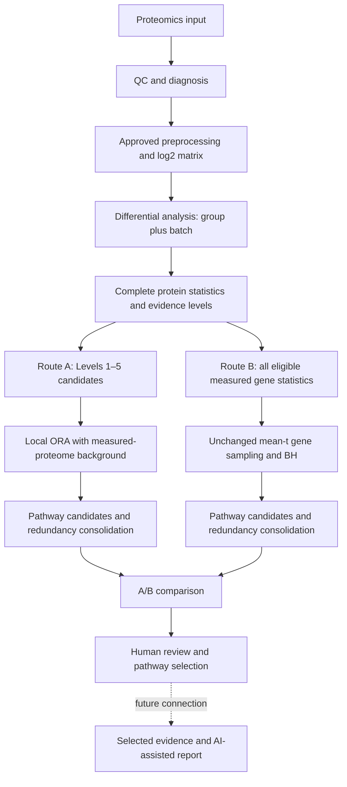

# Proteomics Analysis Pipeline

The production workflow shares one complete successfully tested differential
protein table, runs Route A and Route B independently, and creates deterministic
comparison outputs for human review. Route A means **Protein-Centric Analysis:
Levels 1–5 candidates, local ORA, measured-proteome background**. Route B remains
threshold-independent mean-t pathway analysis.



The current production workflow stops at human review. Automatic B/combined
reporting is not implemented. Existing AI/reporting code is unchanged and still
uses the historical evidence schema; it should not consume production comparison
CSVs directly.

## Installation and shared upstream stages

```bash
python -m pip install -r requirements.txt
python src/qc.py
python src/diagnosis.py --comparison DM_vs_NDM
```

After reviewing diagnostics, call the preprocessing functions in
`src/normalization.py`, apply the approved scaling/log2 choices, and explicitly
save `data/processed/data_log2.csv`. The functions do not automatically persist
that file. Diagnosis never changes the production matrix or automatically removes
outliers. It records versioned reports under `results/diagnostics/diagnosis_###/`.

```bash
python src/differential_abundance.py
```

Differential analysis uses observed values, ordinary per-protein OLS group-effect
t-statistics, batch covariates when multiple batches exist, and protein-level BH.
It requires at least four observations per group by default and rejects perfect
group/batch confounding. There is no batch-subtracted production matrix.

## Production commands

With the existing local gene-set snapshot and differential results:

```bash
# Route A: the single canonical protein-centric workflow, offline
python -m src.pathway_protein --comparison DM_vs_NDM

# Route B: 100k production inference, offline from the pinned snapshot
python -m src.pathway_routes --route pathway --comparison DM_vs_NDM \
  --gene-sets results/pathway_centric/DM_vs_NDM/gene_sets.json

# Route A versus Route B: reads saved results only, offline
python -m src.pathway_comparison --comparison DM_vs_NDM
```

`python -m src.pathway_routes --route protein` also runs canonical Route A. Use
`--route both --gene-sets <snapshot.json>` to run both analyses independently with
one explicit local resource. It does not automatically run comparison or reports.
Dispatcher size/permutation/q/p flags apply to B; A parameter overrides are exposed
by `src.pathway_protein`. Production commands have no A mode/branch choices.

Route A accepts `--gene-sets <snapshot.json>`; absent that flag, it uses the
existing `results/pathway_centric/<comparison>/gene_sets.json`. If no local resource
exists, A fails with instructions rather than silently downloading a new library.
Route B still downloads libraries when run without local definitions. Preserve a
pinned snapshot outside output directories if you maintain several runs/resources.

To regenerate the comparison, repeat only `python -m src.pathway_comparison`.
No upstream statistics are rerun. Existing review selections are preserved.

## Outputs and scientific interpretation

| Output | Location |
|---|---|
| Shared differential protein table | `results/differential_abundance/differential_abundance_<comparison>.csv` |
| Route A results, memberships, levels, universe and provenance | `results/pathway_protein/<comparison>/` |
| Route B results and provenance | `results/pathway_centric/<comparison>/` |
| A/B comparison, detailed proteins, summary, metadata and review selections | `results/pathway_comparison/<comparison>/` |

A uses per-library unique measured genes annotated in that library as its
background. It retains the selected Levels 1–5 candidate rules, upper-tail
hypergeometric tests, BH over all measured terms/libraries/both directions,
adjusted p<0.05 and at least two candidate genes, then seeded Jaccard/Louvain.
All numerical rules are unchanged from the selected numerical workflow.

B remains mean signed gene t with 100,000 size-matched random gene subsets, seed
42, measured pathway size 5–500, and BH across tested terms/libraries. Default
Jaccard threshold is 0.25 and Louvain seed 42 in both routes. B's gene correlation,
ordinary t, duplicate averaging and directionality assumptions are unchanged.

Comparison matches exact versioned library plus GO/Reactome ID where available,
otherwise the exact full term name. A_AND_B/A_ONLY/B_ONLY describe selected
statistical support, not validation or causality. Read coverage flags, separate
protein/gene counts and direction records before interpreting agreement. No
cross-route p/q ranking, combined significance or evidence upgrade is computed.
Neither protein abundance nor pathway direction implies activation/inhibition.

[Comparison guide](docs/PATHWAY_COMPARISON_GUIDE.md) ·
[Architecture](docs/PIPELINE_ARCHITECTURE.md) ·
[Quick review](docs/PIPELINE_ONE_PAGE.md)

## Archive

Historical workflows, results, reports, documents and reference tests are separated
under `archive/route_a_legacy/`. Production source and commands do not import or
read archived workflows/results. Only Route A, Route B and their comparison remain
in the active pathway result trees. See [archive instructions](archive/route_a_legacy/REPRODUCTION.md)
and [the cleanup report](docs/CLEANUP_REPORT.md).

## Validation

```bash
python -m pytest -q
```

Regression tests compare canonical A statistics/memberships/clusters with the
preserved numerical baseline, compare comparison baseline
numerics, verify historical source protection and review preservation, and retain
the frozen Route B regression.

## Route B direction and redundancy diagnostics

The saved threshold sweep is a historical 10k validation record. Current production
outputs directly contain all ten direction/tail/coherence fields; comparison and
protein-evidence views expose them with the `route_b_` prefix. Do not overwrite
the saved sweep when reviewing the promoted 100k production results.

```bash
python -m src.pathway_redundancy_sensitivity --comparison DM_vs_NDM
```

This offline post-analysis command writes enriched direction/coherence views and a
seeded Jaccard-threshold sweep under
`results/pathway_centric/DM_vs_NDM/redundancy_sensitivity/`. It leaves canonical
A/B statistics, memberships, candidates and clusters untouched. The current
recommendation is to retain Jaccard 0.25. See
[the diagnostic review](docs/ROUTE_B_DIRECTION_REDUNDANCY_REVIEW.md) for fields,
component/community distinctions, overlaps and sensitivity results.

## Route B permutation-count sensitivity

The completed historical validation is retained at
`results/pathway_centric/DM_vs_NDM/permutation_sensitivity/`.

This offline inference-only analysis compares 10k/50k/100k permutations using
identical frozen inputs/settings, writes to `permutation_sensitivity/` under the
Route B comparison directory, and never invokes clustering or replaces canonical
results. See [the permutation sensitivity report](docs/ROUTE_B_PERMUTATION_SENSITIVITY.md).
The canonical/default production value is now 100k. The original 10k/50k/100k
validation records are preserved unchanged; the historical sensitivity runner expects
the archived 10k baseline and must not be rerun over these records. See
[the production promotion report](docs/ROUTE_B_100K_PRODUCTION_UPDATE.md).

## Ordinary versus moderated-t validation

The finalized 100k ordinary-t Route B was validated against standard limma 3.54.0
moderation with the same group/batch design. All 28 canonical candidates remain;
four borderline metabolic/ATP-synthesis terms are added. All six major themes
remain supported. Production remains ordinary t. See the
[validation report](results/pathway_centric/DM_vs_NDM/moderated_t_sensitivity/moderated_t_sensitivity_report.md)
and [side-by-side pathway table](results/pathway_centric/DM_vs_NDM/moderated_t_sensitivity/pathway_comparison.csv).

Reproduction code is `src/pathway_moderated_t_sensitivity.py` with
`scripts/moderated_t_limma.R`; it requires R/limma and refuses to overwrite an
existing experiment. Descriptive theme/null review is in
`src/pathway_moderated_t_review.py`. Neither script regenerates production clusters
or comparison outputs.
