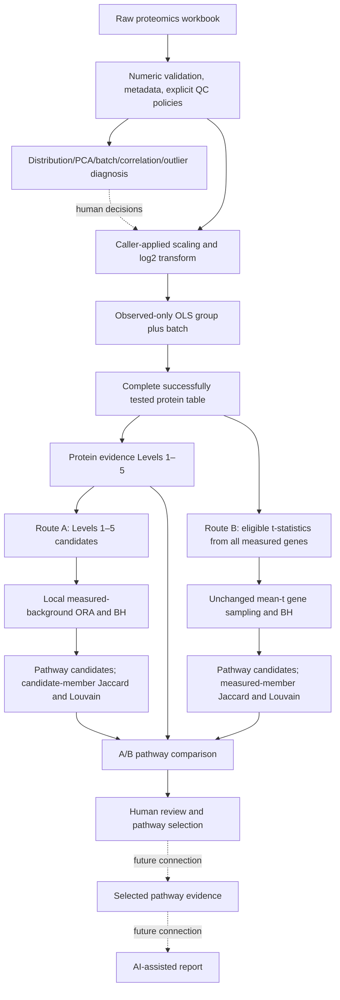

# Canonical production pipeline architecture

October 13, 2026. This document reflects the selected production naming and
workflow. The earlier full audits are preserved under `docs/reference/`; no
historical outputs were moved or deleted.

## Production flow

Dashed downstream connections are not implemented. AI/reporting modules are
unchanged and consume the historical evidence schema, not canonical result or
comparison CSVs. No automatic route integration or reporting is added.

## Active module map

| Stage | Module / entry points | Input | Output |
|---|---|---|---|
| QC | `src/qc.py`: `run_qc_workflow` | `data/raw/abundantdata.xlsx` | QC CSV/pickle, sample metadata and QC tables |
| Diagnosis | `src/diagnosis.py`: `run_diagnosis`; `normalization_diagnostics.py` | QC or chosen matrix + metadata | Incremental `results/diagnostics/diagnosis_###/` |
| Preprocessing | `src/normalization.py`: `apply_conservative_scaling`, `apply_log2_transformation` | Reviewed matrix | Returned copies; caller persists `data/processed/data_log2.csv` |
| Differential analysis | `src/differential_abundance.py`: `run_differential_abundance_analysis` | Approved log2 matrix + metadata | Complete protein table, untested audit, thresholds, figures, metadata |
| Route A | `src/pathway_protein.py`: `run_protein_centric` | Complete DA table + pinned JSON definitions | Single `results/pathway_protein/<comparison>/` tree |
| Route B | `src/pathway_centric.py`: `run_pathway_centric` | Complete DA table + local/live definitions | Existing `results/pathway_centric/<comparison>/` tree |
| Dispatcher | `src/pathway_routes.py`: `run_routes` | Route choice and shared comparison label | Canonical A, unchanged B or both independently |
| Review checkpoint | `src/pathway_comparison.py`: `run_comparison` | Canonical saved A and B + DA table | Standard comparison/review files directly under comparison directory |
| IO/provenance | `src/pathway_review_io.py` | Local resources and paths | Validated definitions, hashes and output protection |
| Historical reproduction | `src/pathway_reference.py` | Explicit reference stage/mode/branch | Original reference paths; outside production |

The selected A statistical functions remain in `src/pathway_measured_ora.py`:
`measured_enrichment(..., 'exploratory')` and `consolidate_measured`. Production
calls the selected branch explicitly, then changes display/schema labels **after**
inference/clustering. The old branch name survives only as an implementation
reference in metadata. No primary family is computed by the canonical writer.
`pathway_analysis.py` provides unchanged level/member helpers as well as the
reference remote ORA path; `pathway_consolidation.py` provides reusable graph/
ranking functions as well as its reference branch writer.

## Shared upstream scientific contract

Metadata defines sample IDs, group, batch and original abundance columns. QC
reports duplication/missingness and applies only supplied nonpositive-value and
exclusion policies. Scaling must precede log2 and assumes comparable central
abundance or stable specified references. Diagnosis is informational, uses
visualization-only median filling, and does not change production data.

DA is ordinary observed-only OLS with a comparison-group indicator and batch
nuisance covariates for multiple batches. It defaults to DM minus NDM, four
observations per group, rejects rank deficiency and stores protein-specific df,
standard errors, group t-values and p-values. BH covers successfully tested
protein rows. These are not moderated t-statistics. CSV input is labeled log2 by
the loader; preprocessing provenance must be maintained by the caller.

## Canonical Route A definition

The production scope is Levels 1–5. Exclusive selection is unchanged:

| Origin | Rule |
|---|---|
| Level 1 | q<.05 and abs(log2FC)>=1 |
| Level 2 | q<.05 and .585<=abs(log2FC)<1 |
| Level 3 | q<.05 and abs(log2FC)<.585 |
| Level 4 | p<.05, q>=.05 and abs(log2FC)>=.585 |
| Level 5 | p<.05, q>=.05 and abs(log2FC)<.585 |

Per library, the universe is unique valid measured gene symbols from the complete
DA table intersected with the supplied library's annotation union. Missing/unmapped
symbols cannot contribute. Duplicate genes count once in the universe. Candidate
representatives keep the strongest allowed origin, then q/p/row-position ranking,
followed by increased/decreased filtering.

Test all terms with nonempty measured membership in both directions, including
zero-hit terms. Upper-tail hypergeometric p-values use measured universe size,
measured term size, directional candidate-list size and overlap count. BH jointly
adjusts all terms/libraries/both directions in this single scope. Retain adjusted
p<.05 and >=2 candidate genes by default. Candidate-gene Jaccard>=.25 and weighted
Louvain seed 42 produce communities, retaining singletons and all member terms.
The existing deterministic adjusted-p/annotated-size/support/name ranking selects
representatives. Changing names does not change these rules or their inputs.

Production schema labels are `analysis_type=protein_centric` and
`analysis_label=Route A — Protein-Centric Analysis`. Metadata explicitly records
`analysis_route=protein_centric`, `protein_evidence_scope=Levels 1–5`, numeric
`protein_candidate_levels=[1,2,3,4,5]`, `enrichment_method=local ORA`, and
`enrichment_background=measured proteome / eligible measured genes`, plus detailed
universe, adjustment, cutoffs, seeds, counts, resource/DA/code hashes and versions.

## Route B: unchanged

B eligibility remains valid gene symbol and finite t; duplicate gene statistics
remain arithmetic means. Measured size remains 5–500. Signed mean t is compared
with 10,000 uniformly sampled equal-size subsets without replacement within each
sample, seed 42. Two-sided inclusive plus-one tail probabilities and global BH
are unchanged. Candidate cutoffs remain q<=.05 and p<=1. Membership, direction,
Jaccard and Louvain are unchanged.

The competitive null ignores within-pathway correlation; signed means can cancel
mixed changes. Direction is absolute mean sign while significance is relative to
measured background. The existing live GSEApy loader's annotated-size restriction
still applies when live definitions are used. This update does not resolve any of
these methodological questions.

## Comparison and human review

Standard comparison defaults to canonical A and B and exposes no A mode/branch
CLI. Identity matching is exact versioned library + GO/Reactome ID when available,
otherwise exact full name. Coverage/snapshot disagreement flags remain. Candidate
presence, directional records, representative flags, per-pathway original protein
rows and strongest-origin unique-gene counts retain the previous comparison logic.

Summary/review labels are Route A / Route B / A_AND_B / A_ONLY / B_ONLY. The
canonical table has no user-facing A branch column. Detailed methodology remains
in provenance; historical mode/branch fields remain only in reference comparisons.
The main output is the candidate union, not a new pathway test or merged evidence.

DA/snapshot hashes are checked, A member evidence is validated, and output guards
prevent overlap with source trees. Existing user selection files are preserved on
comparison regeneration. Input changes require checking older selections against
current IDs/categories. No selection triggers an LLM.

## Parameters, resources and outputs

| Parameter | Default |
|---|---|
| A protein scope | Fixed Levels 1–5 |
| A adjusted pathway p / candidate support | strict <.05 / >=2 genes |
| A background | Per-library annotated successfully tested unique genes |
| A correction | BH over terms/libraries/both directions |
| A/B Jaccard / Louvain | .25 / 42 |
| B measured size / samples / sample seed | 5–500 / 10000 / 42 |
| B pathway q / p | inclusive <=.05 / <=1 |

A is local-only and defaults to the established B snapshot; `--gene-sets` can
supply another pinned resource. B retrieval remains unchanged. `--route both`
uses one supplied/default local snapshot for both analyses; inference remains
separate. Production output runs overwrite their own comparison-specific files,
but never rename/delete old variant directories.

Canonical A writes `all_pathways.csv`, `pathway_candidates.csv`,
`pathway_clusters.csv`, `representative_pathways.csv`, `universe_genes.csv`,
`candidate_members.csv`, `protein_levels.csv`, `gene_sets.json`,
`analysis_metadata.json` under `results/pathway_protein/<comparison>/`.
Comparison writes `pathway_comparison.csv`, `pathway_protein_evidence.csv`,
`comparison_summary.json`, `comparison_metadata.json`, `pathway_review_selection.csv`
directly under `results/pathway_comparison/<comparison>/`.

## Historical separation and validation

Old remote A results, measured-primary/selected pre-canonical results and four
comparison directories stay at their original locations. Reference entry points
and documentation are listed in [REFERENCE_WORKFLOWS.md](REFERENCE_WORKFLOWS.md).
The existing report/evidence commands remain reference consumers; they are not
wired into the production flow during this naming update.

Tests retain legacy A and frozen B checks, compare canonical A numerical fields,
identities and memberships exactly to the selected reference branch, compare
canonical/reference comparison numerical fields, and ensure reference files and
user selections survive production writes. No live API is needed for these checks.
