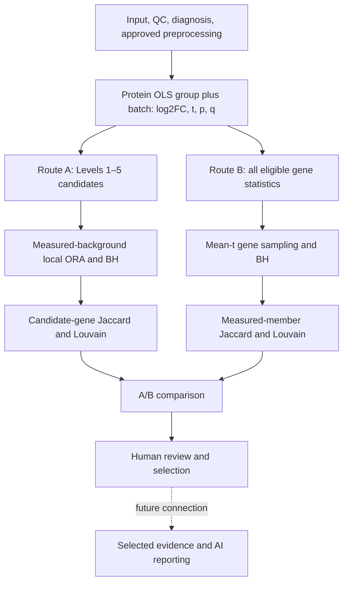

# Production pipeline: quick review

Canonical naming update: October 13, 2026. Route A is Protein-Centric Analysis:
Levels 1–5 + measured-proteome-background local ORA. No other A variant is an
active production choice. Route B is unchanged.

| Feature | Route A | Route B |
|---|---|---|
| Protein cutoff | Fixed exclusive Levels 1–5 | None beyond eligibility |
| Gene duplicates | Existing strongest candidate row | Existing mean protein t per gene |
| Statistical question | Candidate overlap beyond measured expectation | Mean t unusual versus equally sized measured subsets |
| Null/background | Library-specific annotated measured unique genes | All eligible unique measured genes |
| Adjustment | BH across libraries/terms/both directions | BH across tested terms/libraries |
| Pathway retention | Adjusted p<.05; >=2 candidate genes | q<=.05 and p<=1; measured size 5–500 |
| Direction | Increased/decreased candidate lists | Absolute mean sign; mixed-sign flag |
| Clustering | Candidate membership | All measured membership |

Shared defaults: Jaccard>=.25, Louvain seed 42. B sampling remains 10,000 with seed
42. Protein thresholds: q<.05 with absolute FC bounds 1/.585 for Levels 1–3;
nominal p<.05 and q>=.05 for Levels 4–5.

Run `python -m src.pathway_protein`, then B with a pinned `--gene-sets` resource,
then `python -m src.pathway_comparison`. Results are in
`results/pathway_protein/<comparison>/`, `results/pathway_centric/<comparison>/`
and `results/pathway_comparison/<comparison>/`. Repeating only the comparison
command regenerates the review tables without statistical inference.

A_AND_B means convergent selected statistical support, not validation. Exact
library/identity matching and coverage flags prevent forced equivalence. Separate
protein-row and strongest-origin unique-gene counts preserve duplicate evidence.
P/q values cannot be ranked across methods. There is no automatic B/combined AI
reporting; existing AI code remains tied to historical evidence.

[Detailed guide](PATHWAY_COMPARISON_GUIDE.md) ·
[Architecture](PIPELINE_ARCHITECTURE.md) ·
[Historical references](REFERENCE_WORKFLOWS.md)
