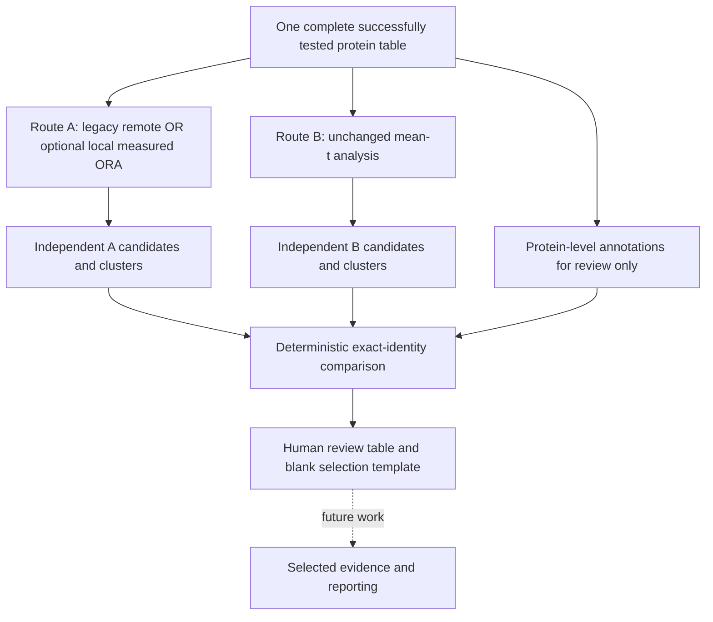

# Pathway comparison and measured-background Route A

Controlled update: October 13, 2026. This checkpoint compares independently produced results for human review. It does not combine statistical evidence, change Route B, invoke AI, or make measured-background Route A the default.

## What the routes ask

**Route A** asks whether selected individually differential genes occur in a pathway more often than expected under its ORA background. Primary uses exclusive protein Levels 1–3; exploratory uses Levels 1–5, including stronger levels. Increased and decreased gene lists are tested separately. Protein selection still uses the existing strict p/q thresholds and absolute fold-change bounds.

**Route B** asks whether a measured pathway's mean gene t-statistic is unusual relative to random equally sized subsets of eligible measured genes. All eligible finite t-values contribute regardless of protein significance. Gene t-values remain arithmetic means of eligible protein rows; ordinary t-values, sampling assumptions/count, absolute direction, BH correction, candidate selection and clustering are unchanged.



The existing AI reporting system is still Route A-specific. Do not pass B/comparison CSVs to its evidence loader. The selection template stores review intentions only, with no automatic analysis or reporting consequence.

## Optional measured-proteome background: exact definition

Legacy A remains `src/pathway_analysis.py` and its original entry points/output directories. New `src/pathway_measured_ora.py` requires a local JSON database snapshot and runs a separate methodological variant.

For each library L:

1. Read the complete successfully tested DA table; apply existing A validation and annotation normalization.
2. Normalize valid gene symbols by stripping whitespace and uppercasing, exactly as A already does. Missing symbols cannot map. No accession conversion, synonym resolution, isoform parsing or new mapping API is added.
3. Collapse the measured background to unique symbols, regardless of p/q/FC/direction. One gene has one opportunity in ORA even when represented by multiple protein rows.
4. Intersect these symbols with the union of every supplied pathway's genes in L. This is `U_L`, the library-specific experimentally eligible annotated universe.
5. Keep A's existing candidate representative selection: strongest allowed origin, lowest q, lowest p, row position, then direction filter. Intersect that list with U_L. Genes absent from L do not contribute to either the library universe or its submitted candidate list.

`universe_genes.csv` records every valid measured symbol and whether it entered each library's universe. Candidate rows and annotations remain in `protein_levels.csv`; the original DA data are untouched. Duplicate proteins still appear separately in review evidence.

For a term T, use measured membership `T intersection U_L`. Set N=|U_L|, K=|T intersection U_L|, n=number of submitted candidate genes, x=candidate/term overlap. Calculate `hypergeom.sf(x-1, N, K, n)`, equivalent to one-sided Fisher greater for:

| | In term | Outside term |
|---|---:|---:|
| Candidate | x | n-x |
| Not candidate | K-x | N-n-K+x |

Every term with at least one measured gene is tested in **both directions**, including zero-hit terms (p=1). A direction with no candidates also yields p=1. No measured members means no test. BH is calculated separately for primary and exploratory branches over all tested libraries/terms/both directions in that branch. The table records all four cells, universe size, measured term size and annotated size. See [SciPy's Fisher exact documentation](https://docs.scipy.org/doc/scipy/reference/generated/scipy.stats.fisher_exact.html) for its hypergeometric equivalence.

Candidate/support rules remain adjusted p **<0.05**, at least **two unique candidate genes** by default, followed by A's Jaccard/Louvain defaults and representative ranking. Zero candidates produces valid empty revised A files. Unlike B's size filter, the new ORA tests every nonempty measured term: A has no new 5–500 restriction.

The current remote A call does not supply an experimental universe. GSEApy offers background-related interfaces, but simply adding an argument to named remote-library calls does not transparently guarantee the selected per-library universe and BH family. This update therefore uses local, auditable SciPy/statmodels inference. **P/q values are expected to change** from legacy A because the background, term family and correction are explicit and different. They are not silently replaced, and measured A is not routed into existing reports by default.

New output directory: `results/pathway_analysis_measured/<comparison>/`. Both branches are written. Its metadata records the local source path/hash, exact universe/duplicate rules, model/adjustment/support parameters, software versions, DA dataframe hash and copied snapshot hash. The database names are user-supplied versioned resource labels; a release date is not independently verified. Using B's snapshot aligns the supplied libraries but inherits any filtering performed when that snapshot was originally downloaded.

## Matching and coverage

Match by **exact versioned library name plus pathway identity**:

- Extract a single `GO:ddddddd` or `R-XXX-digits` identifier if present in the term label.
- Otherwise use the unchanged full pathway name, including capitalization and whitespace.
- Never fuzzy-match names, equate different releases, merge databases, or infer equivalence from a shared description.
- An ambiguous label with multiple IDs, or duplicate aliases in one source/direction, raises an error.

A and B may have different names for the same stable ID within an exact library; both names are preserved. KEGG/custom entries lacking a recognized ID use exact full names. A direction is **not** part of pathway identity in the main comparison, so a pathway with both A directions has one row retaining both directional records.

Legacy default A: BP2023, Reactome2022, KEGG Human2021. B: BP/CC2023. Only BP is shared by these defaults. Optional measured A uses whichever supplied snapshot libraries are present (the commands below use B's BP/CC snapshot). This changes library scope relative to legacy A and must be accounted for when comparing variants.

`directly_comparable` flags exact-library coverage and whether the B term was tested. Known differing A/B definition snapshots are excluded. For a legacy term absent from returned A results, a shared local snapshot establishes annotation/evaluability, **not an observed A p-value**; the missing p/q stays blank and `a_term_in_saved_results=false`. Definition equivalence with historical remote legacy A is unknown. A local snapshot is not proof of what the service used historically.

`comparison_summary.json` distinguishes:

- `comparable_pathways` / `comparable_saved_result_pathways`: distinct identities with saved results in both routes, excluding known snapshot disagreements (a coverage count, not candidate overlap; historical definition equality can still be unknown).
- `comparable_candidate_pathways`: candidate-union rows meeting the recorded coverage policy.
- `categories` versus `comparable_categories`: all candidate categories versus the coverage-filtered subset.

When a library is absent, B size filtering excluded the term, or snapshots differ, an absent candidate is **not** evidence that the other method failed to detect the same biology. The coverage flags and definition-agreement field must accompany interpretation of the category.

## Categories, direction and statistical evidence

Main rows are the union of A pathways retained after support filtering/consolidation and saved B pathway candidates. “Present” means selected candidate support, not merely appearing in the complete test table.

| Category | Meaning | Does not establish |
|---|---|---|
| A_AND_B | Same exact identity is retained by both chosen analyses | Experimental validation, causality, activity, or independent replication |
| A_ONLY | Retained A protein-centric support; not a saved B candidate | Absence of coordinated biology, especially if B did not test it |
| B_ONLY | Retained B pathway-level signal; not retained by A | No strong individual proteins, or biologically confirmed pathway activity |

The category is descriptive; coverage can make A_ONLY/B_ONLY uninformative as disagreement. It also depends on the selected A branch, universe variant and cutoffs. Primary and exploratory comparisons are kept separate.

Never numerically rank an A p/q against a B p/q as though they measured the same effect. ORA and mean-t sampling ask different questions, use different nulls and adjustment families, and have different resolution. No combined p/q, pooled cluster or upgraded evidence strength is computed.

All A directional statistics and assignments are retained in JSON columns. The scalar A display p/q comes from the row with the lowest adjusted p, then p, then direction. `route_a_display_direction` identifies that row. This is a display selection, **not** a valid combined pathway p-value. `route_a_direction` lists retained candidate directions; `route_a_tested_directions` includes all saved test directions.

Direction agreement maps a single retained A increased/decreased direction to B positive/negative. Multiple A directions or zero B direction are `not_meaningful`. A term with both signs can still be A_AND_B without directional agreement. B's `mixed_signs` flag is preserved and its absolute mean-sign versus background-relative significance limitation remains unchanged.

## Protein and gene counts

Levels are attached after analyses, for interpretation only:

- L1: q<.05 and absolute log2FC>=1.
- L2: q<.05 and .585<=absolute log2FC<1.
- L3: q<.05 and absolute log2FC<.585.
- L4: p<.05, q>=.05 and absolute log2FC>=.585.
- L5: p<.05, q>=.05 and absolute log2FC<.585.
- Non-candidate: all remaining successfully tested rows.

`level_<n>_protein_count` counts DA rows. `level_<n>_gene_count` counts unique symbols, assigned the strongest origin among their measured protein rows. A gene with a candidate and a non-candidate isoform contributes one gene to the strongest candidate level, while both protein rows remain visible. Non-candidate gene count includes only symbols with no candidate row. These gene-summary rules describe composition, not changes to either route's duplicate treatment.

Detailed `pathway_protein_evidence.csv` preserves `row_position`, accession, original gene name, normalized symbol, all DA statistics, origin, per-snapshot membership, A contributing-row/selected-gene flags and B contributing-row flag. A contributing-row flag reflects membership in the saved directional candidate-member evidence, which can include contributions to terms that did not pass pathway selection; the separate selected-gene flag identifies retained A support. B contribution includes every eligible measured row of a tested term, whether or not that term's candidate label comes from A.

Full measured totals are derived from available local definitions, not only A candidate hits. If both known snapshots differ, evidence contains their membership union with `in_a_definition`/`in_b_definition` flags; these totals are not asserted to be one shared statistical set. If a legacy-only library has no snapshot, only known A candidate rows are shown, `membership_complete=false`, and total/level-composition counts are unknown (blank), not falsely zero. Supply additional nonconflicting local definitions with `--gene-sets` to improve coverage. Missing definitions and partial memberships affect global composition summaries as well.

Genes shared between pathways appear in several detailed rows. Per-pathway counts must not be summed as unique study-wide support. Summary unique counts deduplicate across the displayed union; they can be lower bounds when memberships are incomplete.

## Outputs, provenance and review

Comparison output variants are separate to avoid overwriting primary/exploratory or legacy/measured reviews:

```text
results/pathway_comparison/<comparison>/<legacy|measured>_<primary|exploratory>/
    pathway_comparison.csv
    pathway_protein_evidence.csv
    comparison_summary.json
    comparison_metadata.json
    pathway_review_selection.csv
```

The main table includes identity, names, coverage, membership totals, composition, p/q, directions, candidate member counts, identities, clusters and representative flags. The metadata includes absolute input paths and file SHA-256 hashes, embedded A/B methods/cutoffs, matching/counting/direction policies and the shared DA dataframe hash.

B's recorded DA/snapshot hashes and measured A's hashes must match. Legacy A lacks a historical complete-input hash; its saved protein members are checked against current DA row position, symbol, level and statistics, but that verifies only represented evidence and cannot prove whole-input identity retrospectively. Do not claim this stronger provenance guarantee for historical legacy outputs.

Default/custom output guards reject source-directory overlap and input files within the destination. No source result writer is invoked during comparison. Review decisions are initially blank. Suggested human entries are `A`, `B`, `both`, `exclude` with an explanation in `review_notes`. They do not invoke a model. Existing selection files are preserved when regenerating comparison tables; check IDs against changed inputs/cutoffs before reusing older decisions, or save a fresh review under another directory through the Python API.

## Commands in order

Assume QC, approved preprocessing and the complete `differential_abundance_DM_vs_NDM.csv` already exist, as they do in this repository. Use one pinned snapshot for revised A and B. The saved B snapshot is available now.

### 1. Generate Route A

Legacy/reference mode (internet required; remote Enrichr may rate-limit; skip if its saved results are adequate):

```bash
python -m src.pathway_routes --route protein --comparison DM_vs_NDM
```

Optional measured-background mode (offline; generates both A branches independently, does not replace legacy):

```bash
python -m src.pathway_measured_ora --comparison DM_vs_NDM \
  --gene-sets results/pathway_centric/DM_vs_NDM/gene_sets.json
```

### 2. Generate Route B only if necessary

Offline from the same saved snapshot (normal B calculation, unchanged):

```bash
python -m src.pathway_routes --route pathway --comparison DM_vs_NDM \
  --gene-sets results/pathway_centric/DM_vs_NDM/gene_sets.json
```

Without `--gene-sets`, B downloads definitions and needs internet. Do not rerun if its existing saved results and input hashes already meet your comparison requirements. No upstream DA run is needed for this update.

### 3. Generate comparison/review outputs

All offline; these commands read saved results without ORA or mean-t inference:

```bash
python -m src.pathway_comparison --comparison DM_vs_NDM --a-mode measured --a-branch primary
python -m src.pathway_comparison --comparison DM_vs_NDM --a-mode measured --a-branch exploratory
python -m src.pathway_comparison --comparison DM_vs_NDM --a-mode legacy --a-branch primary
python -m src.pathway_comparison --comparison DM_vs_NDM --a-mode legacy --a-branch exploratory
```

### 4. Inspect and reproduce

Open the corresponding `pathway_comparison.csv` and detailed evidence CSV in a spreadsheet editor, then review summary/metadata JSON and annotate the selection template. Rerun only the desired comparison command to regenerate tables from existing inputs. Regeneration preserves your existing selection file. Inputs/hashes must match; errors should be resolved rather than bypassed.

```bash
cat results/pathway_comparison/DM_vs_NDM/measured_exploratory/comparison_summary.json
python -m pytest -q
```

## Decisions still requiring scientific review

1. Is per-library annotation-restricted measured universe the desired ORA background, and is branch-wide BH over libraries and both directions the preferred correction family? Revised A remains optional pending review.
2. Should comparisons eventually harmonize A/B library scope, or preserve each route's native libraries? Current matching does not invent correspondence.
3. Is candidate presence after support filtering the preferred review definition? The pre-support significance flag and complete directional results allow inspection of the distinction.
4. Are strongest-origin gene composition and separate protein-row counts sufficient for future isoform interpretation?
5. How should incomplete historical provenance and unavailable definition snapshots be handled before making biological comparisons?
6. Review retained pathways and selection decisions before designing B/combined reporting. All previously identified B methodological questions remain open and unchanged.
