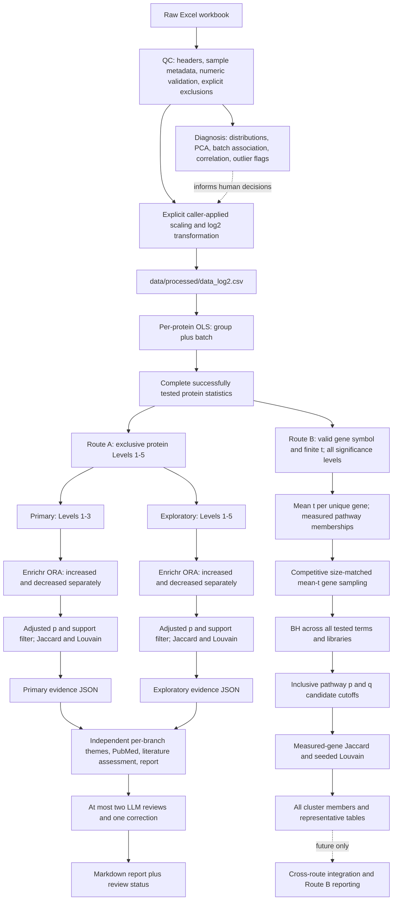
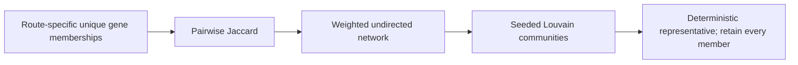
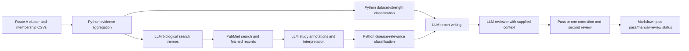
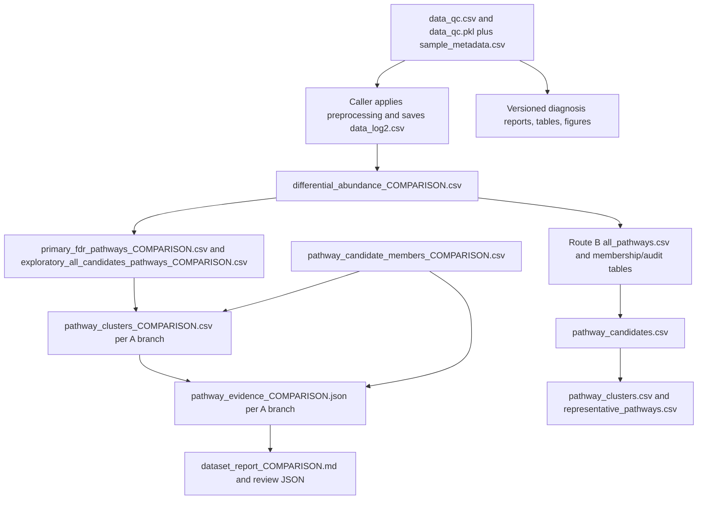

# Proteomics pipeline: implementation audit

Audit date: October 11, 2026. Scope: current working-tree Python implementation, including the uncommitted Route B extension. This is a documentation audit; no analysis code was changed, no production analysis was rerun, and no external requests were made. Paths below are relative to the repository. Function names identify the implementation anchors; the README was checked separately rather than treated as the source of truth.

## 1. Current high-level architecture



The conceptual reconnection of both routes into reporting is **not implemented**. Route B ends at CSV/JSON outputs. Existing evidence/report modules require Route A levels and fields. Primary and exploratory are branches *within Route A*, not synonyms for Route A and Route B.

There is no single raw-to-report orchestrator. `pathway_routes.run_routes` orchestrates enrichment/consolidation only, running A then B sequentially for `both`. It does not invoke QC, preprocessing, differential analysis, evidence building, or reporting. If A raises an exception, B is not reached. Independently running B remains possible.

## 2. Module and file map

| Stage / module | Important entry points | Inputs / upstream dependency | Outputs and disk files | Parameters / external resources |
|---|---|---|---|---|
| `src/qc.py` | `run_qc_workflow`, `load_raw_data`, `promote_first_row_to_header`, `create_sample_metadata`, `apply_nonpositive_value_policies`, `apply_approved_exclusions` | `data/raw/abundantdata.xlsx`; abundance column naming convention | `data/processed/data_qc.csv`, `data_qc.pkl`, `sample_metadata.csv`, `sample_qc.csv`, `protein_qc.csv`; returned QC summary | Explicit exclusion lists, peptide minimum, zero/negative policies; pandas/openpyxl; no network |
| `src/normalization_diagnostics.py` | `run_normalization_diagnostics`, `assess_distribution`, `assess_pca`, `assess_batch_effects`, `assess_correlation_heatmap`, `assess_hierarchical_clustering`, `assess_outliers` | QC dataframe/pickle and metadata, or caller-provided transformed dataframe | Figures under `figures/normalization_diagnostics/`; prefixed tables under `results/normalization_diagnostics/`; returned diagnostics | Visualization-only missingness filter/median filling; PCA, scipy/sklearn; no network |
| `src/diagnosis.py` | `run_diagnosis`, `reserve_next_run_directory`, `build_diagnosis_summary`, `render_diagnosis_report` | Diagnostic runner, data/metadata paths, scale label | `results/diagnostics/diagnosis_###/diagnosis_report_<comparison>.md`, copied `figures/` and `tables/`, `latest_diagnosis.json` | Versioned diagnostic wrapper; comparison is a label, not the DA contrast configuration |
| `src/normalization.py` | `apply_conservative_scaling`, `apply_log2_transformation` | QC dataframe and authoritative metadata | Returned copies, scaling-factor table and summaries; **no automatic disk writer or CLI** | Median/reference scaling, target, linear-scale guard; no batch subtraction |
| `src/differential_abundance.py` | `load_final_analysis_data`, `run_differential_abundance`, `report_candidate_thresholds`, `run_differential_abundance_analysis` | `data/processed/data_log2.csv`, `sample_metadata.csv` | Complete/filtered protein CSVs, untested audit, threshold summary, metadata under `results/differential_abundance/`; primary/exploratory figures | Contrast groups, minimum observations, plot limits; statsmodels OLS and BH |
| `src/pathway_analysis.py` | `assign_candidate_origin`, `run_candidate_enrichment`, `_default_enrichr_runner`, `build_pathway_candidate_members`, `add_pathway_priorities`, `run_pathway_analysis` | Complete DA table | Primary/exploratory enrichment, candidate memberships, priority CSVs under `results/pathway_analysis/`; figures | Named Enrichr libraries, organism; live `gp.enrichr` |
| `src/pathway_consolidation.py` | `reconstruct_pathway_gene_sets`, `calculate_jaccard`, `build_similarity_network`, `cluster_similarity_network`, `_rank_cluster_members`, `consolidate_analysis`, `consolidate_pathways` | Route A enrichment and member CSVs | Per-branch `pathway_clusters_<comparison>.csv`, `consolidation_metadata_<comparison>.json`; optional excluded-support CSV | Adjusted p, candidate-gene minimum, Jaccard, Louvain seed; NetworkX; no network |
| `src/pathway_centric.py` | `prepare_proteins`, `load_gene_sets`, `test_pathways`, `select_candidates`, `consolidate_candidates`, `run_pathway_centric` | Complete DA table; supplied JSON/dictionary or downloaded definitions | Seven tables, database snapshot and metadata under `results/pathway_centric/<comparison>/` | Mean-t sampling/size/cutoffs/seeds; `gp.get_library` only when definitions not supplied |
| `src/pathway_routes.py` | `run_routes`, `main` | Existing DA CSV; `--route protein/pathway/both` | Calls existing A stages and/or B writer | New CLI options apply to B, apart from shared comparison/route |
| `src/evidence_builder.py` | `build_branch_evidence`, `build_pathway_evidence`, `_strongest_gene_levels` | A cluster CSVs, A memberships, consolidation metadata | `results/pathway_consolidation/<branch>/pathway_evidence_<comparison>.json` | Fixed primary/exploratory levels, schema validation; no network |
| `src/agents/dataset_report_agent.py` | `DatasetReportAgent`, `PubMedClient`, `OpenAIResponsesClient`, `GeminiClient`, `dataset_evidence_strength`, `disease_relevance` | Evidence JSON, disease, prompts; retrieved abstracts | Theme/assessment caches; returned Markdown and retained review context | PubMed E-utilities; selected LLM provider; retrieval/batching limits |
| `src/agents/scientific_reviewer.py` | `ScientificReviewerAgent.review`, `.run`, `ReviewOutcome` | Draft, evidence, retrievals, deterministic classifications | Review cache; final report and pass/manual-review outcome | Selected provider/model, fixed two-round bound; no independent literature search |
| `src/generate_pathway_report.py` | `parse_args`, `build_llm_client`, `main` | Evidence JSON and `prompts/dataset_report_prompt.txt`, `prompts/scientific_reviewer_prompt.txt` | `results/pathway_reports/<branch>/dataset_report_<comparison>.md`, `cache/`, `review/` | Disease/comparison required; provider/model/reviewer and cache flags |

Direct commands are independent scripts. Existing default script entry points hard-code many defaults; changing Python function arguments is distinct from having a CLI flag. No central configuration file or workflow engine enforces consistency.

## 3. Shared upstream workflow

### Input, identifiers and sample metadata

QC reads the workbook and, by default, promotes its first data row to headers. Abundance recognition uses `^Abundance\.(?:NDM|DM)_B\d+_\d+$`: ingestion is tailored to DM/NDM naming, even though downstream DA functions permit other contrast names. `create_sample_metadata` extracts group, batch and sample number and generates sample IDs such as `DM_B1_01`. Required fields are `sample_id`, `group`, `batch`, `original_column`. Sample IDs and original columns must be unique. Metadata order defines abundance-column order throughout processing.

QC converts abundance/analysis numeric fields, reports duplicates and peptide problems, and rejects malformed/infinite abundance values. Duplicate accessions or rows are diagnosed rather than automatically collapsed. Only explicitly requested samples, row indices, accessions or peptide-count exclusions are applied. Missing peptide counts fail a requested peptide minimum. Accession, gene name, protein name and peptide counts are carried into DA where available; missing annotations do not inherently prevent OLS.

### Missing values, transformations and diagnosis

QC defaults to errors for zeros and negatives. Explicit alternatives are zero `set_missing`/`allow` and negative `exclude_rows`/`allow`; no pseudocount or shift is introduced. An allowed nonpositive value will still fail the later strict-positive log2 transform.

`apply_conservative_scaling` multiplies each sample by target/reference median. The default reference is all observed proteins; alternatively use explicitly supplied stable protein accessions. Default target is the median of sample medians. Scaling precedes log2, preserves missing values and row order, and returns a new dataframe. It assumes comparable central abundance or valid stable references. `apply_log2_transformation` requires observed values to be finite and positive, preserves missing values and marks `abundance_scale=log2`.

Neither function writes `data_log2.csv`; callers must persist the chosen preprocessing result. Therefore the documented script sequence has a manual/programmatic preprocessing gap. The DA CSV loader labels input as log2 without independently proving that the numbers were transformed. CSV also loses dataframe attributes such as `scaled`, so metadata can understate scaling history; the pickle preserves attributes.

Diagnosis does not transform production data or choose exclusions/model covariates automatically. It checks distributions, PC1/PC2, partial group/batch associations, Pearson correlations, sample clustering and potential outliers. PCA/clustering temporarily retain proteins observed in at least 50% of samples, fill remaining missing entries with protein medians, and remove zero-variance features. These filled values never feed DA. Outlier flags combine at least two of four criteria (missingness, low correlation, robust PCA distance, unusual median abundance), using robust thresholds around 3.5; flags require review.

Batch diagnosis fits nested PC-score models and computes partial F tests and unique R-squared contributions, with a BH batch assessment. This describes the PC1/PC2 subspace, not all variation. Diagnosis runs are versioned and report the supplied scale; scale labels are not inferred proofs.

### Differential model and statistics

`run_differential_abundance` subsets samples to reference/comparison (defaults NDM/DM), constructs an intercept and comparison indicator, and includes dummy batch terms when at least two batch levels exist. The design is `abundance ~ group + batch`, with a group-only fallback for one batch. No batch-corrected abundance matrix is created. Global rank deficiency, including perfect confounding, aborts analysis.

Each protein uses its observed values only. At least four observations in **each** group are required by default; there is no production imputation. The observed-row design must have full rank and more observations than parameters. Insufficient coverage, failed fits, nonestimable designs and nonfinite statistics enter `untested_proteins_<comparison>.csv`.

Statsmodels ordinary OLS returns the group coefficient, standard error, t-value and two-sided t-test p-value with protein-specific residual degrees of freedom. `log2FC` is the fitted group coefficient (DM minus NDM by default), not necessarily the raw difference between reported group means. `t_statistic = coefficient / standard_error`. These are **ordinary, unmoderated** t-statistics. BH (`fdr_bh`) adjusts across all successfully tested protein rows in the contrast; untested rows are excluded from that family. Positive t and log2FC indicate greater fitted abundance in the comparison group. Row positions map to the final input dataframe and remain the primary row-level identifier.

Scientific assumptions include independent samples, an additive estimable group/batch model and conventional OLS error/variance assumptions. Neither clinical confounders nor paired/repeated-measure terms are added. Missingness-dependent exclusion can change which proteins/pathways are measurable and can bias group comparisons if missingness reflects abundance.

## 4. Route A: protein-centric analysis

`assign_candidate_origin` validates the complete table, requiring unique nonmissing row positions and finite log2FC/t/p/q. Malformed rows fail this route rather than being individually audited and skipped. Candidate levels use strict p/q inequalities and inclusive fold-change bounds:

| Exclusive origin in pathway analysis | Exact condition |
|---|---|
| Level 1 | q < 0.05 and absolute log2FC >= 1.0 |
| Level 2 | q < 0.05 and 0.585 <= absolute log2FC < 1.0 |
| Level 3 | q < 0.05 and absolute log2FC < 0.585 |
| Level 4 | p < 0.05, q >= 0.05 and absolute log2FC >= 0.585 |
| Level 5 | p < 0.05, q >= 0.05 and absolute log2FC < 0.585 |
| Not candidate | All remaining rows |

The earlier DA threshold summary is **cumulative**, not this exclusive partition. DA Level 4/5 threshold masks can include FDR proteins; exploratory figure selection explicitly removes stronger levels. Conversely, Route A exploratory **pathway enrichment includes Levels 1–5**, rather than only Levels 4–5. This distinction affects interpretation of “exploratory.”

Gene symbols are stripped and uppercased. Blank/missing symbols cannot enter enrichment. One representative per gene is selected globally within the allowed origins: strongest origin, lowest q, lowest p, then row position. Direction filtering follows representative selection using positive/negative log2FC; zero log2FC enters neither list. Multiple gene symbols embedded in one annotation are not resolved/split or accession-converted.

Primary (`primary_fdr`) uses Levels 1–3; exploratory (`exploratory_all_candidates`) uses Levels 1–5. `run_candidate_enrichment` invokes `gp.enrichr` for nonempty increased and decreased lists independently. Defaults: `GO_Biological_Process_2023`, `Reactome_2022`, `KEGG_2021_Human`; GO Cellular Component is not a Route A default. It submits candidate symbols and library names, organism lowercased, `outdir=None`, `no_plot=True`. Up to four list submissions occur across the two branches and directions, followed by library-specific result requests.

This is remote Enrichr overrepresentation analysis. **The code supplies no measured-protein background**. Statistical background and adjusted p calculation are delegated to the installed GSEApy/Enrichr service path. The local module accepts returned `P-value` and `Adjusted P-value`; it does not calculate its own pathway BH or combine all libraries/directions into one family. A precise numerical remote universe/version cannot be recovered from these output fields alone. It must not be described as a measured-proteome ORA or as sharing B's global BH family.

Returned `Genes` determine long-format candidate membership, with representative protein annotations/statistics. Overlap numerator is submitted genes found in the term, denominator is database term size; gene ratio is overlap/submitted gene count. Priority derives from strongest contributing protein level; it does not alter p-values. Complete returned enrichment tables and a priority summary are written, with separate primary/exploratory plots.

Consolidation independently filters each branch at adjusted p **< 0.05** and requires at least **two reconstructed unique candidate genes** per term. Missing significant pathways or no supported terms raises an error; this can interrupt `both` before B runs. Jaccard and Louvain follow Section 7. Representatives are statistical exemplars; biological search-theme names are generated later by the LLM, not during clustering.

## 5. Route B: pathway-centric analysis

### Eligibility and membership

`prepare_proteins` requires only `Gene.name` and `t_statistic`. It does not inspect protein p/q/FC/levels, validate accession existence, or validate all other DA statistics. Symbols are stripped/uppercased, missing symbols and nonfinite/non-numeric t-values are excluded with reasons. Where both are invalid, missing-symbol is the reported reason. Gene spelling, obsolete symbols and species correctness are not validated.

Every eligible row contributes to an arithmetic mean t per unique gene. This prevents repeated symbols inflating set size, but averaging t-values is a methodological choice, not a new calibrated gene-level t-test. Opposite protein/isoform effects can cancel. The eligible universe includes valid genes even if they belong to no retrieved pathway. Input audit keeps original rows and an `input_row` positional identifier; existing `row_position` remains if supplied.

`load_gene_sets` calls `gp.get_library(name=library, organism=organism)` for each library unless a dictionary is supplied. Defaults are GO BP/CC 2023. In installed **GSEApy 1.3.1**, `get_library` also defaults to total annotated size 0–2000, with no gene list supplied. Terms larger than 2000 annotations are discarded **before** B intersects them with measured genes. This hidden upstream restriction can exclude a broad GO term with fewer than 500 measured members, and omitted terms are absent from B's audit/snapshot. Supplied JSON bypasses that library-loader filter, so identical intended databases can yield different term families by input mode.

Within B, pathways intersect the eligible unique-gene universe; default tested measured size is **5–500 inclusive**. Below/above-size reasons enter `gene_set_audit.csv`. Tested membership preserves all measured genes and expands back to every eligible original protein row in `pathway_members.csv`. Unmeasured annotations are available in `gene_sets.json`, subject to the loader restriction above.

### Exact mean-t sampling test

Let U be N eligible unique genes, t_g the mean eligible protein t for gene g, and S a term's k measured genes:

`M(S) = (1/k) * sum(t_g for g in S)`.

For every distinct tested k, generate B=10,000 independent uniformly sampled k-element subsets of U, **without replacement within a subset**, with replacement of subsets across iterations. Compute each subset's mean t. This randomizes membership labels relative to the observed statistic vector; it does not shuffle samples or refit differential models.

The RNG is `default_rng(SeedSequence([seed, k]))`, default seed 42. Null vectors are shared across terms/libraries with the same measured size and generated in sorted library/term traversal. Normal route preparation sorts the gene index. Reproducibility depends on the same gene vector, seed, sizes and software, not seed alone.

For observed mean M and null means M_b:

- L = `(1 + count(M_b <= M)) / (B + 1)`.
- H = `(1 + count(M_b >= M)) / (B + 1)`.
- p = `min(1, 2 * min(L, H))`.

Inclusive tails handle ties conservatively; plus-one correction prevents zero p-values. Minimum possible p is 2/10001, approximately 0.00020. BH across **all tested terms in all requested libraries together** produces q-values. A larger testing family or inadequate tail resolution can limit attainable discoveries; more permutations improve resolution/Monte Carlo stability but do not fix the null's scientific assumptions.

The null asks whether the term's mean is extreme **relative to the eligible measured background**, whose mean need not be zero. For example, mean t=+0.2 can be unusually low in a globally positive background and thus have a significant two-sided p while still being labeled positive. Direction is the absolute sign of M, not the tail relative to the background. This distinction needs scientific review.

`direction` is positive, negative or exactly-zero non_directional. `mixed_signs` records whether measured gene means contain both signs; it is a flag, not a separate mixed-regulation test. Exactly zero is rare and has no tolerance band. Cancellation means strong bidirectional changes may yield a weak mean signal. Neither direction nor significance establishes biological activity.

`select_candidates` retains p **<= 1** and q **<= 0.05** by default; both are configurable. Complete tests are retained separately from candidates. Saved tables can be passed back to selection/clustering functions; there is no dedicated reselection CLI.

### Interpretation and PIANO distinction

This is a competitive mean-t random-set test inspired by the user's PIANO description. It does not reproduce moderated t estimation, every PIANO directionality class, a correlation-preserving sample permutation, or the exact reference-paper settings. No specific paper/PDF was supplied for line-by-line verification. Gene exchangeability is the null assumption. Within-pathway correlations, missingness/detectability differences and gene-dependent statistic distributions can invalidate that assumption or alter calibration. Size matching controls set cardinality, not correlation or annotation bias. It is threshold-independent, but still restricted to proteins passing upstream DA estimability and annotation requirements.

### Output and provenance

Metadata records comparison/route, databases/organism, statistic, eligible protein/gene counts, exclusions, duplicate rule, test, measured-size limits, p/q cutoffs, BH family, sampling count/seed, Jaccard/Louvain settings, tested/candidate/cluster counts, direction policy and limitations. It hashes normalized database JSON and a reserialized DA dataframe and records installed numpy/pandas/statsmodels/networkx/gseapy versions. The DA hash is not necessarily the raw original CSV byte hash.

There is **no download timestamp, source URL/local-input path, cache-hit marker or explicit database release record beyond the library name**. The snapshot improves reproducibility but is not automatically reused on later runs. Output files replace the same comparison's previous B outputs. All tables support zero tested/candidate terms, although no eligible genes raises an error.

An already-present `DM_vs_NDM/analysis_metadata.json` records 1,947 eligible proteins / 1,946 genes, 18 exclusions, 1,617 tested terms, 28 candidates and 11 clusters. These are existing artifacts read during the audit, not newly rerun or independently validated scientific findings.

## 6. Route A versus Route B

| Feature | A: protein-centric | B: pathway-centric |
|---|---|---|
| Starting input | Complete tested-protein DA table | Same table |
| Uses all proteins in pathway test? | No: candidate genes only | All eligible mapped measured genes, regardless of significance |
| Individual cutoff | Fixed protein q/p and FC tiers | None after DA eligibility |
| Statistical unit | Submitted candidate gene overlap with term | Mean gene-level t of measured term members |
| Method | Remote Enrichr ORA | Local competitive mean-t sampling |
| Background/null | Remote service background, not measured universe supplied by code | Eligible measured unique genes; random equal-size subsets |
| Direction | Separate positive/negative FC lists | Signed mean t; mixed-sign flag |
| Multiple testing | Protein BH upstream; returned Enrichr pathway adjustment | Protein BH unused for selection; global BH over tested terms/libraries |
| Pathway candidate rule | Adjusted p < 0.05 then >=2 candidate genes | q <=0.05 and p <=1; measured size 5–500 |
| Libraries by default | GO BP 2023, Reactome 2022, KEGG Human 2021 | GO BP and CC 2023 |
| Redundancy | Candidate-gene Jaccard; seeded Louvain | All measured-member-gene Jaccard; same graph/community functions |
| Reporting | Primary/exploratory evidence and LLM reports supported | Standalone tables only |
| Biological question | Are threshold-selected changes concentrated in this annotation? | Is the measured term's signed mean t unusual versus size-matched measured genes? |

A may detect a small strong subset in a broad pathway despite neutral/opposite remaining members. B may detect coherent modest changes whose individual proteins fail q/p cutoffs. B can miss opposing-sign regulation through cancellation; A is cutoff-sensitive and depends on remote background. Differences in libraries, membership universe, adjustment families and support limits mean route disagreement cannot yet be interpreted as pure biological disagreement.

## 7. Shared redundancy framework



`J(S,T)=|S intersection T|/|S union T|`. The shared network sorts identities, adds every term as a node, and creates an edge when J >=0.25. Identity is `(analysis_type, direction, library, term)`; pairs with different analysis type or direction cannot connect. Different databases can connect within a direction. Edge weight equals Jaccard. Louvain uses weight and seed 42; graph isolates are retained as singleton communities. Membership overlap and graph modularity define statistical groups, not GO semantic similarity or proof of a single coherent biological theme.

| Setting / rule | Route A | Route B |
|---|---|---|
| Shared implementation | `build_similarity_network`, `cluster_similarity_network` | Imports the same functions |
| Jaccard / Louvain defaults | 0.25 / 42 | 0.25 / 42 |
| Members used | Reconstructed selected candidate genes | All eligible measured genes in term |
| Support filter | >=2 unique candidate genes after pathway adjusted p | Measured size >=5 before test; no additional candidate-support filter |
| Upper size | No local total-term maximum in consolidation | Measured maximum 500; live loader also annotated maximum 2000 |
| Representative rank | Lowest adjusted p, largest annotated overlap size, largest gene ratio, largest candidate count, lexical library/term/direction/type | Lowest q, then p, lexical library/term |
| Cluster numbering | Communities ordered by representative identity | Communities ordered by minimum member identity |
| Empty candidate outcome | Error if no significant/supported terms | Valid empty result tables |
| Zero-weight edges | Shared A graph can retain zero edges at threshold 0 | B removes zero-weight edges before Louvain |

A's annotated-size tie-break favors broader terms when adjusted p ties, which is not necessarily greater specificity. B's q/p rule favors statistical evidence; tied q-values are common. Fixed seeds reproduce a specified graph/software, but parameter perturbations or Louvain versions can change communities. Raising Jaccard usually creates fewer edges/more fragmentation; community counts are not guaranteed monotonic. All cluster pathways remain in audit tables; “redundancy removal” is representative designation rather than deletion.

## 8. External dependencies and the reported HTTP 429

This audit inspected the **installed GSEApy 1.3.1 source** as well as repository call sites; behavior may differ under another installed version. Dependencies include numpy, pandas, matplotlib, sklearn, scipy, statsmodels, gseapy, networkx, openpyxl and google-genai. Version ranges in `requirements.txt` are not a fully pinned environment.

| External operation / code anchor | Why needed and what is sent | What comes back | Current caching / offline status |
|---|---|---|---|
| A: `pathway_analysis._default_enrichr_runner` -> `gp.enrichr` | ORA for candidate symbols; sends increased/decreased lists, named libraries and organism | List/job ID and remote per-library enrichment results including p/adjusted p/member genes | No project enrichment cache; saved CSVs can be used downstream offline but enrichment reruns contact server |
| B: `pathway_centric.load_gene_sets` -> `gp.get_library` | Obtain pathway definitions; sends organism and library name, **not protein statistics or a submitted gene list** | Available-library names and downloaded term/gene definitions | GSEApy writes a library GMT to its own cache, but the inspected download path issues GET before writing and does not read that saved file to avoid download; no project cache-first policy |
| Local B: `pathway_routes.main --gene-sets` | Read JSON library -> term -> symbols | In-memory definitions | Fully local core analysis after dependencies/input are available; supports saved B `gene_sets.json` explicitly |
| `PubMedClient.search`, `_get` | Search disease plus LLM theme plus rolling five-year dates; then fetch PMIDs; optional NCBI email/API key | XML records, title/abstract/publication types/identifiers | No persistent retrieval cache; searches/fetches run on each report generation even when LLM assessment cache is usable |
| `OpenAIResponsesClient.json_response` | Theme naming, literature assessment, writing, optional revision/review; sends structured evidence, disease, prompt and retrieved studies as relevant | JSON model response | Theme/assessment and reviewer caches can avoid some calls; writing is always requested during generation; no explicit adapter retry loop |
| `GeminiClient.generate`, `.json_response` | Same logical tasks through google-genai | Text/parsed JSON | Same logical caches; transient retries at 2/4/8/16 seconds for 429/500/502/503/504 |

No separate live accession-to-gene conversion is implemented. PubMed sends disease/theme searches and PMID lists, not raw abundance matrices. LLMs receive evidence/annotations/abstracts and review context, not the full sample abundance matrix in the normal workflow. B local testing and consolidation make no network calls. `--preview-queries` avoids PubMed, report writing and reviewer requests, but **can invoke an LLM to name themes** if the theme cache is unavailable; it also initializes the selected provider client and requires its credentials.

### Exact error-generating operation

The supplied text is:

```text
gseapy.enrichr.EnrichrAPIError: Error sending gene list, status code: 429
```

Installed GSEApy's `Enrichr.send_genes` raises that exact message when `self._session.post(url, files=payload, verify=True)` returns a non-OK response. `Enrichr.get_results` calls it at `f"{self.base_url}/addList"`, sending a `list` and `description`, then retrieves results using `userListId`.

The repository path reaching this operation is:

```text
pathway_routes.run_routes(route='both' or 'protein')
 -> pathway_analysis.run_pathway_analysis
 -> run_candidate_enrichment
 -> _default_enrichr_runner
 -> gp.enrichr
 -> Enrichr.get_results
 -> Enrichr.send_genes: POST /addList   <-- exact error message originates here
```

This call is needed by **the current remote Route A ORA implementation** to register each nonempty candidate list. It is not needed by Route B's local mean-t test. B's library retrieval is a different path: `get_library` -> available-library-name GET -> `download_library` -> `EnrichrAPI.download_libraries`, GET `/geneSetLibrary?mode=text&libraryName=...`. Its library failure message is different in the inspected version.

Therefore the exact error is consistent with A running first under `--route both`. The pasted message contains no traceback identifying branch, direction or command invocation. It does **not** establish that the standalone `--route pathway` invocation produced this list-submission exception; if it did, the runtime/version/code path must be checked using its complete traceback. No failing live request was reproduced during this audit.

There is no project-level Enrichr 429 backoff or shared cache. GSEApy's own session behavior is dependency-specific and should not be treated as a pipeline guarantee. A does not download B-style definition dictionaries, so the current `both` path is not literally two calls to the same definition downloader. It repeatedly submits A lists and then loads B libraries; passing B a snapshot does not eliminate A's requests. A future local ORA change would require explicit background/adjustment parity review; it cannot be assumed numerically equivalent to the remote service.

The prior pasted cache/retry request has **not** been implemented in this audit. JSON offline definitions are supported now; a dedicated GMT flag/parser, source/date provenance, cache-first loading and shared resource policy are outstanding design work. GSEApy can parse a `.gmt` name when passed through its library API, but the pipeline does not expose a clear versioned GMT workflow or metadata convention.

## 9. Evidence, literature, AI and review separation



`evidence_builder` validates branch type, cluster size, exactly one representative, metadata/count consistency and allowed origins. It unions candidate genes across each cluster and assigns each gene its strongest allowed protein level. Stored counts refer to unique genes, although downstream report packets label their sum `total_proteins`; repeated protein/isoform rows are not separate evidence units. It records representative/member pathways, best adjusted p, representative gene ratio, singleton flag, and evidence metadata. Primary permits Levels 1–3; exploratory permits 1–5; neither upgrades the other.

`dataset_evidence_strength` is deterministic:

- STRONG if Level 1 count >=2, or Level 1 >=1 plus combined Levels 2–3 >=2.
- Otherwise MODERATE if combined Levels 1–3 >=2.
- Otherwise EXPLORATORY.

This measures fixed protein-tier support, not a newly calibrated cluster-level significance probability. It is not suitable for B without a new schema/rule set.

The LLM proposes one biological search theme per cluster and annotates retrieved papers. PubMed searches theme AND disease in title/abstract within a rolling five-year publication window and ranks by relevance, default maximum 20 records per cluster. Results can omit relevant older literature and synonyms. Abstracts are truncated to 6000 characters in LLM literature payloads; these are abstract-based assessments, not full-text systematic review.

`disease_relevance` uses supplied study annotations deterministically: HIGH requires >=3 direct supporting primary studies with >=2 classified mechanistic/clinical/disease_progression; MODERATE requires any direct primary support or any primary closely related model; otherwise LOW. **The classification rule is deterministic, but its input support/type judgments are LLM-derived** (with publication-type validation constraints). It is not independent objective validation of literature quality or causality.

The report writer receives fixed evidence packets, classifications, retrievals and literature assessments. Python validates exactly one returned section per cluster and assembles them in evidence order; prose remains LLM-generated. Theme and literature assessment caches hash their inputs, but do not include selected provider/model as explicit fields in their input hash, allowing model changes to reuse earlier assessments unless refreshed. Reviewer cache inputs include provider/model and report/context hashes.

The scientific reviewer receives the draft and supplied evidence/retrieval/assessment/classification context, makes no outside searches, and validates errors against six categories: dataset fidelity, unsupported interpretation, literature fidelity, citation fidelity, classification mismatch, completeness. Maximum two reviews allow at most one writer correction. Unresolved problems yield `manual_review_required`; the report is still saved with separate unresolved-issues JSON. Reviewer pass is not external scientific verification. `--skip-review` disables this layer; `--reviewer-model` can choose another model from the same provider.

## 10. Parameters and configuration map

Exposure: **CLI** denotes an argument in an existing CLI; **function** denotes a Python argument only; **fixed** denotes a constant/rule requiring code change. Increasing/decreasing a cutoff changes interpretation as indicated; graph/community counts need not be monotonic.

| Parameter | Current default | Module / exposure | Scope | Purpose and effect |
|---|---|---|---|---|
| Raw input / header promotion | `abundantdata.xlsx` / True | qc, function | Shared | Workbook structure; false requires existing correct headers |
| Sample/row/accession exclusions | None | qc, function | Shared | Explicit removal changes analyzed cohort/universe |
| Minimum peptide count | None | qc, function | Shared | Higher cutoff removes more/poorly supported rows; missing counts excluded when enabled |
| Zero / negative policy | error / error | qc, function | Shared | Missing conversion or exclusion changes coverage; allow does not make log2 legal |
| Scaling method / reference IDs | median / None | normalization, function | Shared | All observed proteins versus selected stable references; chosen biological assumption changes normalization |
| Scaling target / protein ID column | median of sample medians / Accession | normalization, function | Shared | Higher target rescales linear abundance globally; references must match identifiers |
| Scale guard / log transform | linear assumption; log2 | normalization, function/fixed | Shared | Prevent repeat transform; CSV attrs do not persist automatically |
| Diagnosis comparison/data/metadata/scale | DM_vs_NDM / QC pickle / sample metadata / linear for CSV | diagnosis, CLI | Shared | Select diagnostic input and label; not DA model configuration |
| PCA/clustering minimum observed fraction | 0.50 | normalization_diagnostics, function | Diagnostic | Higher value removes more diagnostic features; never directly filters DA |
| Diagnostic correlation | Pearson | normalization_diagnostics, function | Diagnostic | Similarity definition; runner explicitly requests Pearson |
| Diagnostic hierarchy metric/linkage | correlation / average | normalization_diagnostics, function | Diagnostic | Changes sample dendrogram; not pathway Louvain |
| Outlier robust threshold / combined flags | 3.5 / >=2 | normalization_diagnostics, fixed | Diagnostic | Looser thresholds flag more; no automatic exclusion |
| Median-shift diagnostics | linear CV>=0.15 AND ratio>=1.50; log2 range>=1 | normalization_diagnostics, fixed | Diagnostic | Flag potential technical/global biological shifts |
| Batch diagnostic signal | strong: p<0.01 AND weighted unique R²>=0.20; otherwise p<0.05 OR R²>=0.10 | normalization_diagnostics, fixed | Diagnostic | PC1/2 exploratory diagnostic criterion; no automatic model change |
| DA reference / comparison | NDM / DM | differential_abundance, function | Shared | Changes contrast sign/cohort; default script uses these defaults |
| DA minimum observations/group | 4 | differential_abundance, function | Shared | Higher value reduces tested rows; lower value accepts weaker coverage |
| DA batch term | Multi-batch inclusion; single-batch omission | differential_abundance, fixed | Shared | Nuisance adjustment; not selected by diagnostic p-value |
| DA protein adjustment | BH over successfully tested rows | differential_abundance, fixed | Shared | Changing tested universe changes q-values |
| Protein q / nominal p | strict <0.05 / <0.05 | differential_abundance + pathway_analysis, fixed | A | Higher hypothetical cutoff admits more proteins; not a route CLI option |
| Protein FC levels | absolute log2FC >=1, >=0.585, or unrestricted | same, fixed | A | Larger bounds focus on larger effects |
| DA top heatmap / volcano labels | 30 / 10 | differential_abundance, function | Shared figures | Presentation limits only; no model effect |
| A libraries / organism | BP2023, Reactome2022, KEGG2021 Human / Human | pathway_analysis, function | A | Changes annotation/tests and service resource; dispatcher B flags do not change A |
| A adjusted pathway p / top plot | strict <0.05 / 20 | pathway_analysis, function | A | Plot threshold/limit; consolidation cutoff separately specified |
| A consolidation adjusted p | strict <0.05 | pathway_consolidation, function | A | Higher retains more terms; should be consistent with enrichment display |
| A minimum candidate genes | 2 | pathway_consolidation, function | A | Higher removes weak-support terms |
| Route / comparison | protein / DM_vs_NDM | pathway_routes, CLI | A/B | both runs sequentially; comparison selects existing DA filename |
| B libraries / organism | BP2023, CC2023 / Human | pathway_routes, CLI | B | Changes definition family; names must exist when live |
| B local definitions | None; `--gene-sets` JSON | pathway_routes, CLI | B | Supplied snapshot bypasses definition network requests and loader filtering |
| Live-loader annotated size | 0–2000 | installed GSEApy default, implicit | B | Hidden filter before measured overlap; not exposed by B CLI |
| B measured min / max size | 5 / 500 | pathway_routes, CLI | B | Larger min drops small sets; larger max admits broad sets and changes BH family |
| B permutations / seed | 10000 / 42 | pathway_routes, CLI | B | More samples improve Monte Carlo precision/resolution at computational cost; seed changes simulated null |
| B pathway q / p | inclusive <=0.05 / <=1 | pathway_routes, CLI | B | Higher cutoffs retain more terms; complete tests unaffected |
| B duplicate gene aggregation | Mean eligible row t | pathway_centric, fixed | B | Equal weights across rows; cancellation/isoform interpretation matters |
| B pathway adjustment | BH across terms/libraries | pathway_centric, fixed | B | Adding libraries can change existing q-values |
| Jaccard threshold | 0.25 | A function; B CLI | A/B defaults | Higher usually fewer edges; different member sets despite equal default |
| Louvain seed | 42 | A function; B CLI | A/B defaults | Fix stochastic clustering given graph/software; no magnitude interpretation |
| Representative rule | A adjusted p then size/support; B q then p/name | respective modules, fixed | A/B | Chooses reporting exemplar, does not delete members |
| Disease / comparison / report branch | Required / required / both | generate_pathway_report, CLI | A reporting | Select literature target and primary/exploratory evidence; branch is not route |
| Provider / model | openai / gpt-5-mini | generate_pathway_report, CLI | Reporting | Literal code defaults, not a model recommendation; provider change requires compatible model |
| Reviewer model / skip-review | Writer model / False | generate_pathway_report, CLI | Reporting | Independent same-provider reviewer or disabled review |
| Maximum studies / literature batch | 20 per cluster / 4 clusters | generate_pathway_report, CLI | Reporting | More records broaden search and payload; larger batch reduces calls/increases context |
| Abstract max characters | 6000 | DatasetReportAgent, function | Reporting | Lower cap loses abstract detail; no full-text retrieval |
| Literature window | Previous five years, rolling dates | PubMedClient, fixed; today function | Reporting | Restricts older foundational evidence; date-dependent results |
| Refresh cache / preview queries | False / False | generate_pathway_report, CLI | Reporting | Refresh repeats LLM work; preview can still call theme LLM |
| Evidence/output override | None | generate_pathway_report, CLI | A reporting | Explicit path only with one branch; B schema unsupported |
| PubMed timeout / throttle | 30s / 0.4s without key, 0.1s with key | PubMedClient, function/constants | Reporting | Reliability/rate control; more delay slower/lower request rate |
| PubMed transient retries | 2,4,8,16s; Retry-After supported | dataset_report_agent, constants | Reporting | Handles 429 and specified 5xx; retrieval itself not cached |
| OpenAI timeout | 120s | OpenAIResponsesClient, function | Reporting | Longer permits slower response; no explicit retry loop |
| Gemini transient retries | 2,4,8,16s | dataset_report_agent, constants | Reporting | Handles configured transient codes; no statistical effect |
| Review bound | 2 reviews, <=1 correction | scientific_reviewer, fixed | Reporting | Bounded expense; unresolved errors remain for manual review |
| Dataset/literature class rules | Section 9 | dataset_report_agent, fixed | A reporting | Not configurable significance tests; labels depend on selected rules/annotations |
| Credentials | OPENAI_API_KEY / GEMINI_API_KEY; optional NCBI_EMAIL/NCBI_API_KEY | Environment | Reporting | Provider authentication; NCBI key alters throttle; never provenance secrets |

Important CLI trap: `python -m src.pathway_routes --route both --q-cutoff ... --libraries ... --jaccard-threshold ...` forwards those options to **B only**. A continues with its existing defaults. A parameters are adjustable through its functions, not through this dispatcher's new flags. Preprocessing similarly has function interfaces rather than a complete production CLI.

## 11. Output lineage and overwrite behavior



`COMPARISON` above is a placeholder; default filenames use `DM_vs_NDM`.

| Directory | Concrete artifacts and consumers |
|---|---|
| `data/processed/` | QC CSV/pickle, metadata and sample/protein QC tables. `data_log2.csv` is the DA default. Existing `data_log2.pkl` can be used through a function path override; default DA reads CSV. |
| `results/diagnostics/diagnosis_###/` | `diagnosis_report_DM_vs_NDM.md`, figures/tables copied from prefixed diagnostics; `latest_diagnosis.json` points to latest. No downstream stage automatically chooses production settings from this report. |
| `results/differential_abundance/` | `differential_abundance_DM_vs_NDM.csv` feeds both routes. `fdr_significant_proteins_...csv`, `nominal_p005_proteins_...csv`, `exploratory_only_p005_proteins_...csv`, `untested_proteins_...csv`, `candidate_threshold_summary_...csv`, `analysis_metadata_...json` support audits; routes do not load the filtered CSVs. |
| `figures/differential_abundance/` | `volcano_DM_vs_NDM.png`, `top_protein_heatmap_DM_vs_NDM.png`; exploratory volcano, `heatmap_all_...png`, and optional `heatmap_top_<N>_...png` in `exploratory/`. Visualizations do not feed tests. |
| `results/pathway_analysis/` | `primary_fdr_pathways_DM_vs_NDM.csv`, `exploratory_all_candidates_pathways_DM_vs_NDM.csv` feed consolidation; `pathway_candidate_members_DM_vs_NDM.csv` feeds consolidation/evidence; `pathway_priority_summary_DM_vs_NDM.csv` is a review table, not evidence builder input. |
| `results/pathway_consolidation/primary/` and `/exploratory/` | `pathway_clusters_DM_vs_NDM.csv` retains all members with representative flags; `consolidation_metadata_DM_vs_NDM.json` validates evidence building; optional `excluded_low_support_pathways_DM_vs_NDM.csv`; `pathway_evidence_DM_vs_NDM.json` feeds reports. |
| `results/pathway_centric/DM_vs_NDM/` | `all_pathways.csv`, `pathway_candidates.csv`, `pathway_members.csv`, `protein_eligibility.csv`, `gene_set_audit.csv`, `pathway_clusters.csv`, `representative_pathways.csv`, `gene_sets.json`, `analysis_metadata.json`. No automatic downstream reporting consumer. |
| `results/pathway_reports/<branch>/` | `dataset_report_DM_vs_NDM.md`; `cache/` theme/assessment/review inputs and responses; `review/review_result_DM_vs_NDM.json`; optional `review/unresolved_review_issues_DM_vs_NDM.json`. |

A and B default result directories do not overlap. B comparison validation guards path-like comparison labels, but custom Python output paths are user-controlled. Production stages overwrite a given comparison's previous files; only diagnosis has incremental run directories. Report filenames include comparison, not disease, so different diseases can overwrite the same report; cache keys include disease. There is no atomic whole-run transaction or manifest linking all stage hashes. Old files can coexist with a partially failed run.

A consolidation constructs an in-memory representative dataframe but writes only the all-member cluster CSV; it removes obsolete `consolidated_pathways_<comparison>.csv` and `cluster_summary_<comparison>.csv`. The representative is recoverable from flags. An obsolete file already present is not evidence that current code produces or consumes it.

## 12. Scientific assumptions to review

| Stage / choice | Why it matters scientifically |
|---|---|
| Median/reference scaling | Broad true group shifts may be reduced by median normalization; unstable references introduce bias. Diagnostic shifts do not identify technical causes by themselves. |
| Missingness and observed-only OLS | Missingness may depend on abundance/group. Coverage exclusions and per-protein sample composition change both model estimates and pathway eligibility. Diagnostic median filling must not be confused with production imputation. |
| Additive batch model | Full confounding is rejected, but partial imbalance can still create uncertainty. Without clinical or repeated-measure covariates, group effects may reflect omitted structure. |
| Ordinary t versus moderated t | Small residual degrees of freedom can produce noisy variance estimates; using existing t preserves upstream modeling but does not reproduce the reference paper's variance moderation. |
| Protein cutoffs and duplicate selection in A | Small threshold changes can change candidate lists/ORA/graphs. Picking the strongest eligible row can privilege one isoform rather than the gene's combined behavior. |
| A remote background and adjustment | A proteomics experiment measures a restricted universe; a remote broad background can produce detectability/annotation bias. Local output does not identify the exact correction family or numerical universe. |
| B gene-level t averaging | T-values from rows with differing coverage/standard errors are averaged equally; the result is a scoring statistic, not an independently calibrated gene t. Opposite isoforms cancel. |
| B competitive null and direction | Gene exchangeability ignores pathway correlations. A pathway can be significant relative to background while its absolute sign gives a different directional impression. Global biological shifts may be weakly detected by competitive tests. |
| Mean and finite sampling | Signed cancellation misses heterogeneous regulation. Tail discreteness/Monte Carlo error affects q values and candidates, especially across many terms. |
| Pathway size and loader restrictions | Small sets may be noisy; large sets dilute specific effects. Hidden annotated-size filtering changes the family before measured-size selection and can vary by input mode. |
| GO/library redundancy | Shared/parent-child annotations produce many dependent tests. BH and representative clustering serve different purposes; clustering does not correct or prove independent pathway evidence. |
| Jaccard and Louvain | A uses candidate-only overlap, B all measured overlap. Identical thresholds can mean different effective similarity. Modularity communities are graph groupings, not ontology-defined biological modules. |
| Representative selection | Lowest q/adjusted p selects an exemplar, not a new cluster p-value. A broad representative or lexical tie-break can shape later themes without stronger mechanistic specificity. |
| Literature and AI classification | Theme choices constrain PubMed retrieval; rolling windows/top records/abstracts omit evidence. Rule-based relevance relies on LLM annotations; reviewer cannot validate omitted or unseen studies. |
| Association versus activity | Abundance/ORA/mean-t direction does not establish activation, inhibition, flux or causation. These routes provide different statistical associations, not automatic mechanistic conclusions. |

## 13. Duplication, gaps and inactive artifacts: flag only

1. **Repeated A list submissions:** primary/exploratory overlap substantially and each direction is remotely submitted; there is no result cache. Running `pathway` then `both` additionally reruns B testing, because saved B tables/snapshots are not automatically resumed.
2. **Library requests repeat:** installed `gp.get_library` validates available names and downloads each named library on each normal call. GSEApy writes GMT files but this inspected path does not prefer them. B `gene_sets.json` can be explicitly supplied to avoid requests; no shared A/B local resource manager exists.
3. **Shared DA is not recomputed:** both routes load saved DA results independently; neither refits protein expression. In `both`, loading the same CSV twice is inexpensive duplication, not duplicate inference.
4. **Repeated member reconstruction:** A selects representatives and reconstructs gene sets multiple times across directions, memberships, consolidation and evidence. B merges all protein memberships, then reconstructs sets for candidates. This supports audits but may cost time with large GO collections.
5. **Diagnostic PCA preparation repeats:** PCA and sample hierarchy prepare similar filtered/filled diagnostic matrices independently. Outlier analysis reuses supplied PCA/correlation outputs in the complete runner. These are diagnostics, not duplicated production DA.
6. **Filtered DA tables and figures are review artifacts:** they are not upstream inputs to enrichment. This is intentional audit/presentation redundancy, not evidence of unused invalid calculations.
7. **A representatives are returned but not separately persisted:** evidence instead recovers them from cluster flags. Old consolidated/summary files are explicitly removed. No additional dormant analysis module was established by this inspection; `normalization_diagnostics.py` remains active through diagnosis and its legacy direct entry point.
8. **Documentation precision gaps:** the README's sequence does not itself produce `data_log2.csv`; its generic end-to-end story should not imply B reporting/integration. B's advertised measured-size rule omits the installed loader's annotated 2000-gene prefilter. Its “full database snapshot” is full only for returned definitions, not necessarily the original remote collection.
9. **Scientific/runtime tests have bounded coverage:** current tests cover numerical eligibility/BH/membership/seed/representative/dispatch and mock Route A comparison against `git show HEAD:src/pathway_analysis.py`. That baseline is moving with HEAD rather than a fixed golden release, and the regression checks enrichment tables/metadata/CSV bytes, not every downstream A stage or live service behavior. There are no cache/offline-library-download tests because cache-first loading is not implemented.
10. **Cross-route comparability remains incomplete:** different default databases, correction families, duplicate-gene rules and overlap sets confound a direct comparison. Candidate overlap alone would not isolate pathway versus protein evidence; no convergence logic is currently implemented.
11. **Reporting cache is incomplete:** themes/assessments/reviews are cached, PubMed retrievals and final writing are not; theme/assessment cache hashes omit explicit model/provider. Changing disease overwrites the same comparison report filename even though cache keys distinguish disease.
12. **Workflow control is sequential and file-based:** `both` aborts if A fails or has no supported pathways; no provenance manifest verifies that all downstream A files belong to the latest DA run. Reruns overwrite outputs instead of retaining parameter-run history.

### Priority manual review decisions

Review before further development: (1) B competitive exchangeability/correlation assumptions; (2) absolute direction versus background-tail interpretation and mixed regulation; (3) ordinary versus moderated t and duplicate-gene averaging; (4) A measured-proteome versus remote enrichment background; (5) harmonized database versions and hidden size filters; (6) Monte Carlo resolution and multiple-testing families; (7) membership/representative/clustering semantics; (8) cache-first resources with source/date/version provenance; (9) preprocessing/run lineage and failure isolation; (10) a separately designed B reporting schema before any evidence integration.

## Controlled-update addendum — October 13, 2026

The preceding audit describes the October 11 baseline. New optional modules add
local measured-background Route A (`src/pathway_measured_ora.py`), resource/input
provenance and output guards (`src/pathway_review_io.py`), and saved-result human
comparison (`src/pathway_comparison.py`). Legacy A, B, DA, route dispatcher and AI
modules remain unchanged. Revised A uses per-library annotated measured unique
genes, upper-tail hypergeometric tests and branch-wide BH over libraries/directions.
Its results are isolated under `results/pathway_analysis_measured/`; comparison
variants are under `results/pathway_comparison/<comparison>/<mode>_<branch>/`.
Neither variant becomes a reporting input or changes the default. Exact identities,
coverage flags, separate gene/protein compositions and blank review selection are
explained in [PATHWAY_COMPARISON_GUIDE.md](PATHWAY_COMPARISON_GUIDE.md).
