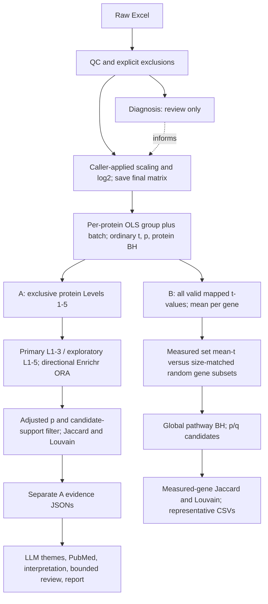

# Proteomics pipeline: quick scientific review

Implementation audit: October 11, 2026. Companion detail: [PIPELINE_ARCHITECTURE.md](PIPELINE_ARCHITECTURE.md). This page describes current code; no analysis changes were made.

## Current architecture

B does **not** currently enter evidence building/reporting. There is no cross-route merge. The route dispatcher runs A then B under `both`; an A failure prevents B execution in that invocation. QC/DA/reporting remain separate commands; preprocessing functions do not automatically save `data_log2.csv`.

## Route comparison

| Feature | A: protein-centric | B: pathway-centric |
|---|---|---|
| Input | Saved complete protein differential table | Same |
| Individual cutoff | Exclusive p/q/FC evidence levels | None beyond finite t and usable gene symbol |
| Gene duplicates | Strongest candidate row | Arithmetic mean eligible protein t per gene |
| Question | Are candidate changes overrepresented in a term? | Is measured term mean t unusual versus equal-size measured gene sets? |
| Test/null | Live Enrichr ORA; no measured background supplied | Local competitive random subsets of eligible measured genes |
| Direction | Separate increased/decreased FC lists | Mean-t sign; mixed-sign flag; sign can differ from background-tail interpretation |
| Pathway adjustment | Enrichr-returned adjusted p | BH across all tested libraries/terms together |
| Redundancy | Candidate-gene overlap | All measured-member-gene overlap |
| Reporting | Primary/exploratory evidence and reports | Tables only |

A may detect a strong subset diluted in B's signed mean; B may detect coherent modest shifts below individual cutoffs. Neither implies biological activation, inhibition, flux or causality.

## Major defaults and review points

| Setting | Current default / rule |
|---|---|
| DA model | DM versus NDM; batch covariate for multiple batches; >=4 observed samples/group; ordinary OLS, no production imputation |
| Protein tiers | L1: q<.05, abs FC>=1; L2: q<.05, .585<=abs FC<1; L3: q<.05, abs FC<.585; L4: p<.05, q>=.05, abs FC>=.585; L5: p<.05, q>=.05, abs FC<.585 |
| A pathways | GO BP2023 / Reactome2022 / KEGG Human2021; adjusted p<.05 and >=2 unique candidate genes |
| B pathways | GO BP/CC2023; measured size 5–500; installed live GSEApy loader also excludes annotated sets >2000 |
| B test | Mean signed gene t; 10,000 size-matched random subsets, without replacement within each; seed 42 |
| B p/q | Twice smaller inclusive plus-one tail, capped at 1; BH across terms/libraries; candidate q<=.05 and p<=1 |
| Shared clustering | Jaccard>=.25; weighted Louvain seed 42; directions separated; singleton retention; all members preserved |
| Representatives | A: adjusted p then size/support and names; B: q then p then names |
| Literature/review | Five-year PubMed window, <=20 studies/cluster; 4 clusters/assessment batch; <=2 LLM reviews, <=1 correction |

**Review first:** gene sampling ignores protein correlation; opposite signs cancel; t-values are not moderated; A and B backgrounds/adjustment families differ; normalization and gene mapping need explicit scientific decisions. B's significant tail is relative to background, while its direction label is relative to zero. These are distinct choices.

**Network finding:** the exact reported `Error sending gene list, status code: 429` comes from installed GSEApy's POST `/addList`, reached by A's `gp.enrichr`. B's `gp.get_library` downloads definitions instead. Full traceback is needed to identify the failed invocation. No cache-first library policy exists yet; B can run offline with an explicitly supplied saved `gene_sets.json`. Snapshot hashes/software versions exist, but source/date provenance does not.

Commands: `python -m src.pathway_routes --route pathway` or `--route both`; B flags control size/permutations/cutoffs/seeds. Outputs: `results/pathway_centric/<comparison>/`. A outputs remain in `results/pathway_analysis/`, `results/pathway_consolidation/<branch>/` and `results/pathway_reports/<branch>/`. The dispatcher's B flags do not change A parameters.

October 13 update: optional measured-background A and deterministic A/B review
now exist. Legacy A and B remain unchanged; there is still no automatic B/combined
reporting. See [the comparison guide](PATHWAY_COMPARISON_GUIDE.md). Results are
separate in `results/pathway_analysis_measured/` and
`results/pathway_comparison/<comparison>/<mode>_<branch>/`.
