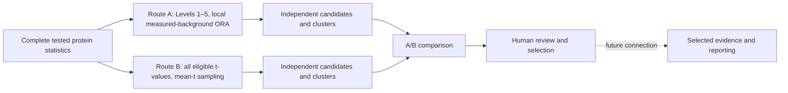

# Route A versus Route B: comparison and review guide

Canonical workflow selected October 13, 2026. Production Route A now means
Protein-Centric Analysis with Levels 1–5 candidates and measured-proteome-background
local ORA. The standard comparison has one Route A and one unchanged Route B.
Historical alternatives are available only as [the archive](../archive/route_a_legacy/REPRODUCTION.md).

## Scientific questions

Route A asks whether individually selected candidate genes are overrepresented
in a term relative to eligible measured genes annotated in the same library.
Route B asks whether all eligible measured members of a pathway collectively have
an unusual mean t relative to random equally sized subsets of the measured gene
universe. Route B does not filter protein p/q/FC/levels.

They remain independent through testing, correction, selection and clustering.
The comparison is a deterministic description of saved results, not another
statistical test. It stops at human review. AI reporting and automatic evidence
integration are not connected to these production outputs.



## Route A methodology: retained exactly

1. Read the complete successfully tested protein table and retain the existing
   exclusive Levels 1–5 protein rules.
2. Normalize valid symbols by trimming and uppercasing. There is no new accession
   conversion, synonym mapping or isoform parsing.
3. For each library, intersect all unique valid measured symbols with the union
   of its annotations. That set is the experimental enrichment universe.
4. Select one candidate row per gene using the strongest origin, then q, p and
   row position; filter increased/decreased direction afterward. Exclude genes
   absent from that library from both its universe and candidate list.
5. Test every nonempty measured term in both directions, including zero-overlap
   terms. With universe N, term size K, candidate-list size n and overlap x, use
   `hypergeom.sf(x-1, N, K, n)`, the upper-tail overrepresentation test.
6. Apply BH across all terms/libraries/both directions within the single Levels
   1–5 scope. Retain adjusted p<.05 and >=2 candidate genes by default.
7. Use existing candidate-member Jaccard>=.25, weighted Louvain seed 42 and
   deterministic representative ranking. Retain every cluster member and isolates.

Universe genes count once even when several protein rows map to one gene.
`universe_genes.csv` audits annotation eligibility; `protein_levels.csv` keeps
all original rows. These definitions, correction family and parameters are
unchanged from the selected pre-canonical method. Names/schema labels change
only after inference and clustering.

Metadata records `analysis_route=protein_centric`, scope Levels 1–5 plus numeric
level list, local ORA, measured background, detailed universe/duplicate rules,
cutoffs, hashes, software versions, sampling-independent clustering settings and
a reference to the original implementation. There is no discarded methodological
information hidden behind the simple Route A label.

## Route B: 100k production and unchanged methodology

B uses mean t per unique eligible gene, measured pathway size 5–500, 100,000
size-matched random subsets and seed 42. Inclusive plus-one two-sided tail p-values,
BH across tested terms/libraries, q<.05/p<=1 selection, absolute mean direction,
mixed-sign flag and measured-member clustering all remain unchanged. Protein
levels attached for review never affect B inference or candidate selection.

Gene sampling assumes exchangeability and does not preserve protein correlation.
Ordinary t-values are not moderated; opposite gene/protein effects may cancel;
a significant deviation relative to the background need not share the direction
of the absolute mean. These scientific questions are still open for later review.

## Identity and coverage

Match by exact **versioned library + pathway identity**. Extract a single GO or
Reactome stable ID where present; otherwise require the unchanged full term name.
No fuzzy names, cross-version equivalence or cross-database pooling is inferred.
Both source names are retained if the same ID has different labels. Ambiguous
IDs/duplicate aliases raise errors rather than being silently merged.

The current canonical A and B use the existing BP/CC2023 local snapshot, aligning
library scope. Custom resources or pathway-size restrictions can still produce
coverage differences. Read `directly_comparable`, `coverage_status`,
`definition_agreement` and saved-test coverage fields. A_ONLY/B_ONLY with
noncomparable coverage is not evidence of biological disagreement.

`comparable_saved_result_pathways` counts matching tested identities, excluding
known snapshot disagreements; `comparable_candidate_pathways` counts comparable
rows in the candidate union. Neither is the count of validated pathways.

## Categories, p/q values and direction

| Category | Interpretation |
|---|---|
| A_AND_B | Same exact pathway retained by both independent route selections |
| A_ONLY | Retained Route A candidate support without saved B candidate support |
| B_ONLY | Retained Route B pathway signal without retained A candidate support |

These are descriptive labels, not independent experimental replication,
validation, activation, inhibition or causal findings. A can detect a strong
subset that is diluted in a signed mean; B can detect coherent modest shifts
below individual cutoffs. Both results depend on their own coverage and choices.

Do not numerically rank A p/q against B p/q: different nulls, units, adjustment
families and precision answer different questions. No merged p/q, upgraded
strength or cross-route cluster is computed.

A may retain both directions for one pathway. Its complete directional records
and cluster assignments are retained in JSON columns. Scalar A p/q displays the
lowest adjusted-p row, then p and direction, with an identifying display direction;
this is not a newly combined p-value. Direction agreement requires one retained
A increased/decreased direction and a positive/negative B direction. Multiple A
signs or a zero B mean are not meaningfully classified as agreement/opposition.

## Protein evidence and counts

Levels remain exclusive: L1 q<.05/absFC>=1; L2 q<.05/.585<=absFC<1;
L3 q<.05/absFC<.585; L4 p<.05/q>=.05/absFC>=.585;
L5 p<.05/q>=.05/absFC<.585. All other rows are non-candidates.

Protein counts use distinct successfully tested row positions. Gene counts use
unique symbols assigned their strongest observed protein origin. A gene with one
candidate and one non-candidate isoform contributes one gene to the stronger tier,
while both protein rows remain visible. This counting convention does not change
either route's duplicate treatment in inference.

The detailed CSV preserves row position, accession, original/normalized symbol,
log2FC/t/p/q, origin, snapshot memberships and route contribution flags. A
contributing-row evidence includes saved directional candidate memberships even
for terms that fail pathway selection; a separate selected-gene flag distinguishes
retained support. B contribution includes all eligible measured rows of tested
terms. Shared proteins appear in multiple pathways: per-pathway counts must not
be summed as unique experiment-wide evidence.

If known definition snapshots differ, detail preserves their union with separate
membership flags; the union is not asserted to be a common statistical set. If
full definitions are unavailable, `membership_complete=false` and unknown totals
remain blank rather than falsely zero. Global summaries can then be lower bounds.

## Production outputs and review

```text
results/pathway_protein/<comparison>/
    all_pathways.csv
    pathway_candidates.csv
    pathway_clusters.csv
    representative_pathways.csv
    candidate_members.csv
    universe_genes.csv
    protein_levels.csv
    gene_sets.json
    analysis_metadata.json

results/pathway_comparison/<comparison>/
    pathway_comparison.csv
    pathway_protein_evidence.csv
    comparison_summary.json
    comparison_metadata.json
    pathway_review_selection.csv
```

The comparison metadata records exact inputs/file hashes, embedded route methods
and cutoffs, matching/counting/direction policies and shared DA identity. A/B
snapshot and DA hashes must match their respective recorded provenance. Member
rows are validated. Output protection prevents writes into source trees.

Review templates display Route A and Route B, without A mode/branch terminology.
Suggested decisions: `A`, `B`, `both`, `exclude`, with notes. Blank means no
selection. No entry triggers reporting. Comparison regeneration preserves existing
review files; after input/cutoff changes, recheck the selected identities and notes.
Production reruns replace their own result files; archived artifacts remain separated from active results.

## Commands going forward

Assume the approved complete DA table and established local snapshot exist:

```bash
# 1. Route A, offline; default resource is the existing B snapshot
python -m src.pathway_protein --comparison DM_vs_NDM

# 2. Route B, offline; skip if saved B results already match the inputs
python -m src.pathway_routes --route pathway --comparison DM_vs_NDM \
  --gene-sets results/pathway_centric/DM_vs_NDM/gene_sets.json

# 3. Standard Route A versus Route B comparison, offline
python -m src.pathway_comparison --comparison DM_vs_NDM

# 4. Regenerate only the comparison: repeat command 3
```

`--route protein` is an alternative A entry point. `--route both --gene-sets PATH`
runs both independently from one local resource, with no automatic comparison.
A can take `--gene-sets PATH`; without a local resource it fails explicitly.
B without a supplied snapshot retains its existing live-download behavior and
requires internet. No production command needs A mode/branch flags.

Parameter overrides for A are available in `src.pathway_protein`; B's dispatcher
flags continue to apply to B only. Use the same pinned input/definitions/parameters
when evaluating rename regression or regenerating a particular comparison.

Archived paths and isolated reconstruction instructions are documented in
[REPRODUCTION.md](../archive/route_a_legacy/REPRODUCTION.md). They are not production options. Existing AI/reporting code still consumes historical evidence, and the
selection-to-report connection is deliberately deferred.
